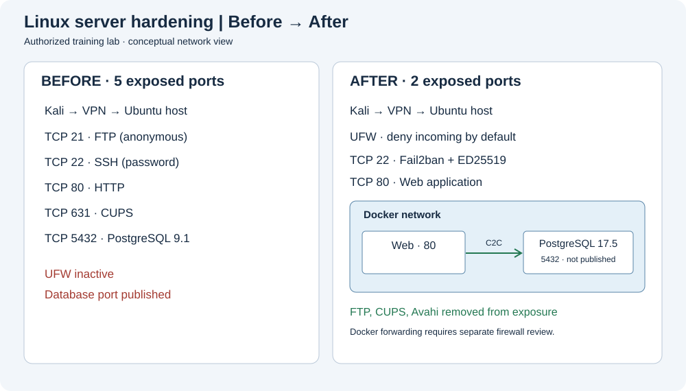

# Linux Server Security Hardening & Vulnerability Assessment

**Hands-on cybersecurity lab | Jedha training | November 2026**

## Overview

I assessed and hardened an Ubuntu 24.04 LTS server hosting a demonstration web application and PostgreSQL in Docker. The goal was to reduce unnecessary network exposure while preserving the application and secure remote administration. All testing was performed in an authorized training environment.

**Outcome:** Five initially identified exposed TCP ports reduced to two (SSH and HTTP), a 60% reduction in the count of those ports—not a measure of overall risk.

## Findings and remediation

| Finding | Remediation | Evidence / outcome |
|---|---|---|
| Anonymous FTP access | Removed vsftpd | FTP no longer listening |
| Weak SSH password | ED25519 key authentication with passphrase; password and keyboard-interactive authentication disabled | Fresh key login succeeded; password-only login refused |
| Root login permitted by key | Set PermitRootLogin no | Effective SSH configuration verified |
| Unnecessary CUPS and Avahi | Stopped, disabled and removed unnecessary services | Listening sockets disappeared |
| PostgreSQL 9.1 and published database port | Backed up demo data, rebuilt lab with PostgreSQL 17.5, removed host port mapping | HTTP application returned database-backed content; external 5432 filtered |
| Inactive host firewall | Enabled UFW with default deny incoming and allow outgoing; allowed TCP 22/80 | Rules and remote access verified |
| No active SSH intrusion-prevention jail | Installed Fail2ban, enabled sshd jail with systemd backend | Filter tested; manual ban/unban verified in nftables and logs |

## Methodology

1. Establish authorized VPN connectivity and enumerate exposed services with Nmap.
2. Compare external scan results with local listening sockets (`ss -tulpn`).
3. Remove unnecessary services and validate the remaining sockets.
4. Back up configuration and database; update PostgreSQL and isolate its port inside the Docker network.
5. Install and test a dedicated SSH public key before disabling password and root login. Use a priority configuration drop-in to override the lab's cloud-init setting.
6. Enable UFW only after allowing required services. Configure and verify Fail2ban.
7. Repeat external scans and test application functionality.

## Before vs after

| TCP port | Service | Initial | Final |
|---|---|---|---|
| 21 | FTP | Open | Filtered |
| 22 | SSH | Open | Open; key authentication |
| 80 | HTTP | Open | Open on final standard scan |
| 631 | IPP | Open | Filtered |
| 5432 | PostgreSQL | Open | Filtered; not published by Docker |

The targeted final scan showed HTTP as filtered, whereas the subsequent standard scan showed it open. HTTP had also been independently tested successfully. A filtered result alone is not proof that a service is absent. Local socket and Docker mapping checks provided additional evidence.

## Evidence

See [evidence index](evidence/README.md) for selected screenshots. Credentials, challenge flags, VPN configuration and private keys are intentionally excluded. The repository documents the work rather than reproducing the course solution.

## Limitations and production recommendations

- Fail2ban filter matching and manual ban/unban were verified separately; a live automatic ban was not tested.
- The standard Nmap scan covered the most common 1,000 TCP ports, not all TCP/UDP ports.
- PostgreSQL 17.5 was the lab target, not a claim of the latest patched release. A production upgrade needs a tested migration and restore plan.
- Apply OS and database security updates, rotate weak local/database credentials, manage secrets securely, deploy HTTPS, restrict SSH sources, review Docker forwarding/firewall rules, and establish backup and monitoring procedures.
- Docker-published ports can bypass ordinary UFW input filtering; database isolation was implemented at the Docker configuration level.

## Skills demonstrated

Linux administration · Nmap · service enumeration · Docker Compose · PostgreSQL · SSH/ED25519 · UFW · nftables · Fail2ban · log analysis · security validation

## Attribution

Independent portfolio summary of an authorized Jedha training exercise. No claim of a production penetration test or independent certification. Course materials and application source are not redistributed.
